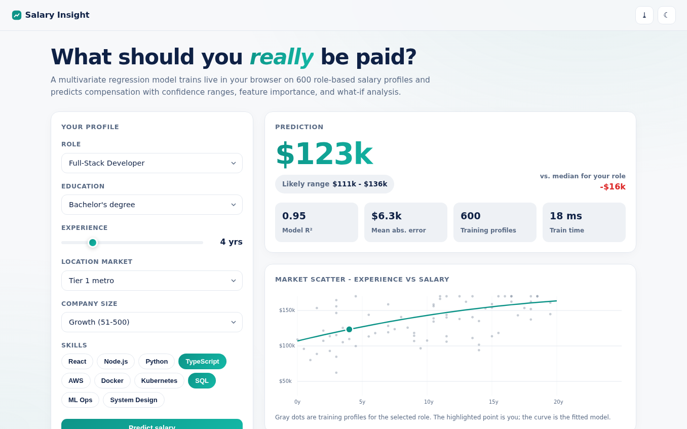
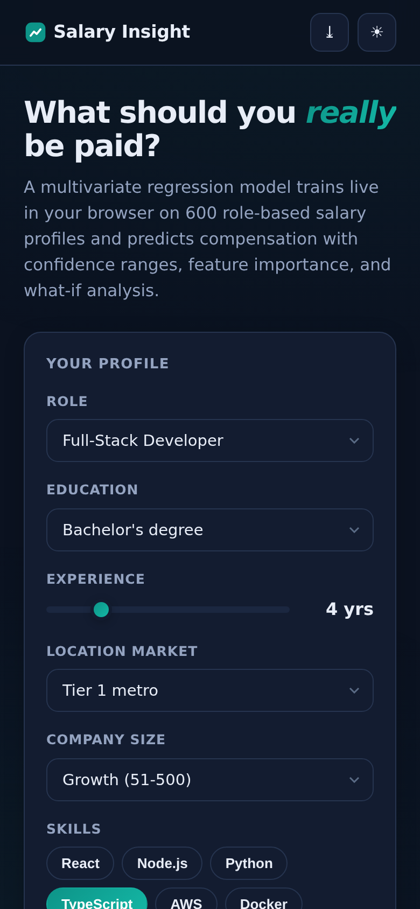

# Salary Insight - ML Salary Predictor

Predict tech compensation with a **multivariate ridge-regression model trained live in your browser** - no server, no API keys, fully offline after first load.

**Live demo:** https://akash991833.github.io/salary-predictor/

## Features

- **Real in-browser ML** - 600-profile synthetic dataset with realistic salary structure; ridge regression solved via normal equations (Gauss-Jordan) in ~12 ms
- **Confidence ranges** - prediction shown with a 90% likely range derived from residual standard error
- **Feature importance** - coefficient x feature-scale bars across experience, education, location, company size, skills, role
- **Market scatter chart** - canvas-rendered experience-vs-salary plot with the fitted model curve and your highlighted position
- **What-if analysis** - instant delta for +2 years of experience
- **Model transparency** - live R-squared, MAE, training set size, and train time
- **PWA** - installable, offline-capable via service worker
- **Premium UI** - white professional design, navy ink, teal accent, flawless dark + light themes, responsive desktop and mobile

## Screenshots




## Tech

Vanilla HTML/CSS/JS. Zero dependencies, zero network calls. Dataset generated with a seeded PRNG so results are reproducible.

## Honest limits

This is a demonstration model trained on a **synthetic dataset** built from realistic tech-salary patterns - not a live market survey. It demonstrates end-to-end regression modeling in the browser. For real compensation decisions cross-check survey sources like Levels.fyi or Glassdoor. This limitation is also stated inside the app.

## Run locally

Open `index.html`, or serve the folder (`python3 -m http.server`) and visit `http://localhost:8000`.

---

## 🐍 Python version (real ML backend) - `python-app/`

The browser demo above is fully client-side. This folder is the **pro-grade version** with a real training pipeline on real data:

Predicts P(income > $50K) from census profile (UCI Adult, 30k records). 86.2% accuracy, AUC 0.93. Stack: Python, Streamlit, XGBoost.

```bash
cd python-app
pip install -r requirements.txt
streamlit run app.py
```

Deploy free on **Hugging Face Spaces** (no card): create a Space, upload the `python-app/` folder - it ships Space-ready (`sdk` + `app_file` already set in its README). Retrain anytime with `python train.py` (where present).
